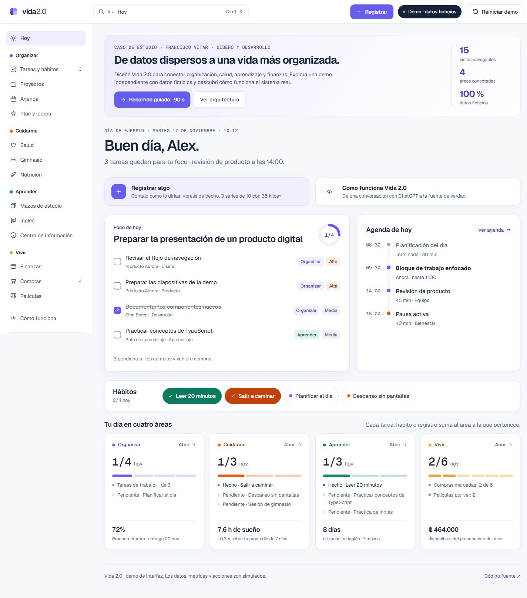
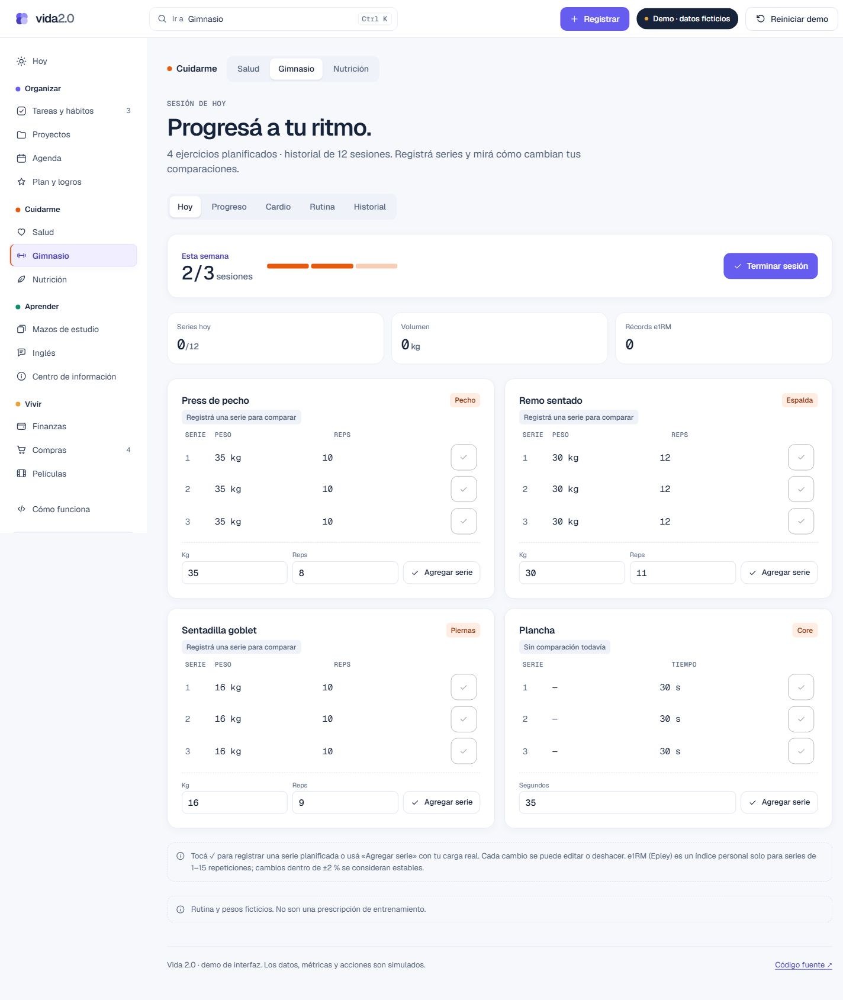
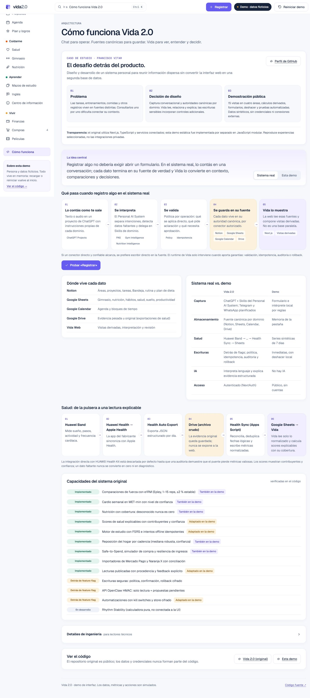

# Vida 2.0 — Demo pública independiente

[](https://github.com/franciscovitar/vida-2-0-demo/actions/workflows/quality.yml)

**[Abrir demo interactiva](https://vida-2-0-demo-genova.vercel.app/)** · **[Caso de estudio y decisiones técnicas](./docs/CASE_STUDY.md)** · [Sistema original](https://github.com/franciscovitar/vida-2.0)

> Diseñada y desarrollada por **Francisco Vitar**. Un sistema para conectar organización, bienestar, aprendizaje y finanzas. La demo es pública, ficticia y no expone las integraciones privadas.

**Recorrido recomendado (90 segundos):** abrí la demo, pulsá **«Recorrido guiado · 90 s»**, probá registrar un gasto, observá cómo cambia Finanzas y terminá en la explicación de la arquitectura.



| Vista de producto | Arquitectura explicada |
| --- | --- |
|  |  |

*Quick English overview:* Interactive showcase of a personal information system. Fifteen connected views, synthetic data, domain calculations, local undo, and a guided walkthrough. The real Next.js/TypeScript system is documented separately; this demo has no connected accounts or AI model.

Demo estática e independiente para visitantes del portfolio de Francisco Vitar. Este repositorio contiene **solo el showcase público**, separado del código y los datos de la aplicación original.

**No es la aplicación personal en producción.** Es una experiencia de producto navegable y aislada, inspirada en Vida 2.0, con una persona y datos completamente ficticios. Su objetivo es que cualquier visitante entienda el concepto en pocos segundos. Es un *showcase interactivo de interfaz*, no una prueba de las integraciones privadas en vivo.

## Propuesta de producto

**«Todo lo que importa. En un mismo lugar.»** Una app para conectar organización, bienestar, aprendizaje y vida cotidiana con una primera vista sencilla. No se promociona como un sistema técnico destinado solo al creador.

| Área | Vistas de la demo | Lo que puede probar el visitante |
| --- | --- | --- |
| Organización | Mi día, Tareas y hábitos, Proyectos, Agenda, Plan y logros | Completar tareas, registrar avances, revisar hitos, filtrar proyectos y explorar eventos |
| Bienestar | Salud, Gimnasio, Nutrición | Registrar series, explorar progreso y benchmark ilustrativo, ver micronutrientes por cobertura y cambiar diario de comidas |
| Aprendizaje | Mazos de estudio, Inglés, Centro de información | Repasar 7 mazos de ejemplo (44 tarjetas), crear/editar/eliminar mazos y tarjetas, practicar inglés y explorar piezas de información |
| Vida cotidiana | Finanzas, Compras, Películas | Simular capacidad de gasto, agregar y marcar productos, aprender cadencias con historial, registrar películas, series, temporadas, comentarios y progreso |

El **Centro de información** representa algunas capacidades de World, Inteligencia y automatizaciones con contenidos **ficticios y atemporales**: no presenta noticias, integraciones ni sincronizaciones reales. No replica el área Profesional personal. Los mazos usan un programador de repaso determinista y simplificado; **no** son una integración con Anki ni una implementación del FSRS del sistema original.

Las acciones se pierden al recargar o presionar **Reiniciar demo**. Las gráficas, importes en ARS, métricas de salud, calorías, ejercicios, puntuaciones y supuestas rachas son ilustrativos. El contenido de nutrición, gimnasio, salud y finanzas no es asesoramiento profesional. Los nombres de películas y sus carteles gráficos son inventados.

**Cómo registrar:** el botón «Registrar» ofrece interpretación local de frases para gimnasio, comida, gastos, tareas y algunas compras del hogar ya conocidas. La pestaña «Formulario» también permite crear **productos de compras**, **películas**, **series**, **mazos** y **tarjetas**, incluso sin escribir una frase. En sus secciones, los controles «Agregar», «Editar» y «Quitar» modifican el estado de la demo, con «Deshacer» y reinicio. Las películas tienen fichas compactas y calificación directa de 1 a 5; las series permiten sumar temporadas y episodios, pausar y reanudar. Quitar un producto de la lista no elimina las compras históricas. Los artículos nuevos del hogar no tienen estimaciones de reposición hasta reunir compras suficientes: el sistema no inventa una frecuencia.

Las ventanas de micronutrientes se calculan solo con días cerrados y alimentos con composición conocida; los umbrales no son indicaciones clínicas. El benchmark de fuerza y la rutina alternativa «V4» son **ejemplos diseñados para la demo**, no el benchmark ni la rutina personal del creador. En «Finanzas › Importar» solo se concilia un extracto ficticio integrado en el código: no admite documentos personales ni conecta bancos.

## Diseño: dirección «Claridad»

La interfaz implementa la dirección A aprobada en Claude Design (brief original en [DESIGN_BRIEF_CLAUDE.md](./DESIGN_BRIEF_CLAUDE.md)):

- **Hoy** como portada: foco del día, agenda con hora fija de la demo (10:12), hábitos y «Tu día en cuatro áreas», que suma cada tarea y hábito al área a la que pertenece.
- **Cuatro áreas** con color propio: Organizar (Tareas y hábitos, Proyectos, Agenda), Cuidarme (Salud, Gimnasio, Nutrición), Aprender (Mazos, Inglés) y Vivir (Finanzas, Compras, Películas).
- Desktop: barra lateral + selector «Ir a» (Ctrl/⌘ K). Tablet y mobile: barra inferior de 5 pestañas y segmentos por área.
- Toda cifra visible se calcula desde `data.js` (ver `logic.js`); no hay tendencias ni relaciones inventadas.

## Estructura

| Archivo | Rol |
| --- | --- |
| `data.js` | Datos ficticios (incluye la hora y el día fijos de la demo y las etiquetas de las series). |
| `logic.js` | Cálculos puros: progreso por área, deltas de salud, ritmo de presupuesto, macros, series del gimnasio. |
| `modules.js`, `src/views/` | Plantillas de las vistas (sin acceso al DOM). |
| `src/domain/` | Validaciones y cálculos puros de captura, salud, gimnasio, nutrición, finanzas y otros dominios. |
| `src/domain/collections.js`, `src/views/collection-fields.js` | CRUD validado de compras, películas, series, mazos y tarjetas; formularios compartidos de registro y edición. |
| `src/data/synthetic.js` | Datos sintéticos complementarios para los recorridos funcionales. |
| `icons.js` | Iconografía propia (trazo 1.75). |
| `app.js` | Estado en memoria, eventos, foco y anuncios accesibles. |
| `styles.css` | Sistema visual: tokens, componentes y responsive. |
| `fonts/` | Geist y Geist Mono autoalojadas (licencia SIL OFL 1.1 en `fonts/OFL-LICENSE.txt`). |

Los valores dinámicos (anchos de barras, alturas) se aplican como variables CSS mediante CSSOM, de modo que la CSP `style-src 'self'` sigue sin permitir estilos en línea.

## Límite de seguridad

- Este directorio **no importa módulos del resto del repositorio**.
- No tiene dependencias instalables de `npm`, backend, autenticación, variables de entorno, APIs ni almacenamiento persistente (`npm test` usa el ejecutor de Node).
- Todas las acciones funcionan con estado en memoria; refrescar vuelve a los datos iniciales.
- Ninguna URL de Google Sheets, Notion o Google Calendar forma parte de la demo.
- Una política CSP explícita fija `connect-src 'none'` para impedir conexiones desde el navegador cuando se sirve mediante la configuración de Vercel incluida.
- Los datos originales de `lib/mock-data` **no se usan**: incluso esos mocks se refieren a ámbitos personales reales.

## Ejecutar en local

Desde este directorio:

```bash
python -m http.server 4173
```

Abrir `http://localhost:4173`. No abrir `index.html` mediante `file://`, porque utiliza módulos ES.

Pruebas (Node.js 22 o superior, sin instalar dependencias):

```bash
npm test
```

El recorrido automatizado de navegador está en `qa/browser_e2e.py`: requiere Python Playwright y Chromium instalados en un entorno que permita ejecutar el navegador. Probá `python3 qa/browser_e2e.py` donde Chromium pueda iniciarse. Su ejecución local sigue condicionada por permisos del entorno; las verificaciones manuales del Preview figuran en [el roadmap](./docs/SHOWCASE_ROADMAP.md).

## Publicación en Vercel

Crear un **proyecto Vercel nuevo** a partir de `franciscovitar/vida-2-0-demo`, con **Root Directory = `./`** y sin variables de entorno. No reutilizar el proyecto Vercel de Vida 2.0 personal, sus credenciales, su alias de QA ni su dominio de producción. Verificar build, cabeceras y acceso público en navegador anónimo.

También puede hospedarse en cualquier hosting estático que permita agregar las cabeceras de seguridad definidas en `vercel.json`.

## QA requerida antes de compartirla

1. Validar las quince vistas navegables (Hoy, trece módulos de área y Cómo funciona), acciones de estado, reinicio y selector móvil.
2. Abrir sin iniciar sesión en desktop y mobile; no debe existir scroll horizontal.
3. Comprobar que no haya solicitudes de red más allá de `index.html`, `styles.css`, `app.js`, `modules.js`, `data.js` y recursos de la plataforma.
4. Verificar el encabezado CSP en la respuesta desplegada.
5. Confirmar que no aparezcan datos personales ni referencias a sistemas externos.
6. Enlazar el código original de Vida 2.0 **separadamente**, sin afirmar que esta demo prueba las integraciones privadas.

Esta demo **no se activa desde la aplicación real** y no sincroniza ningún contenido con ella. Modificar este repositorio no modifica Vida 2.0 personal.
