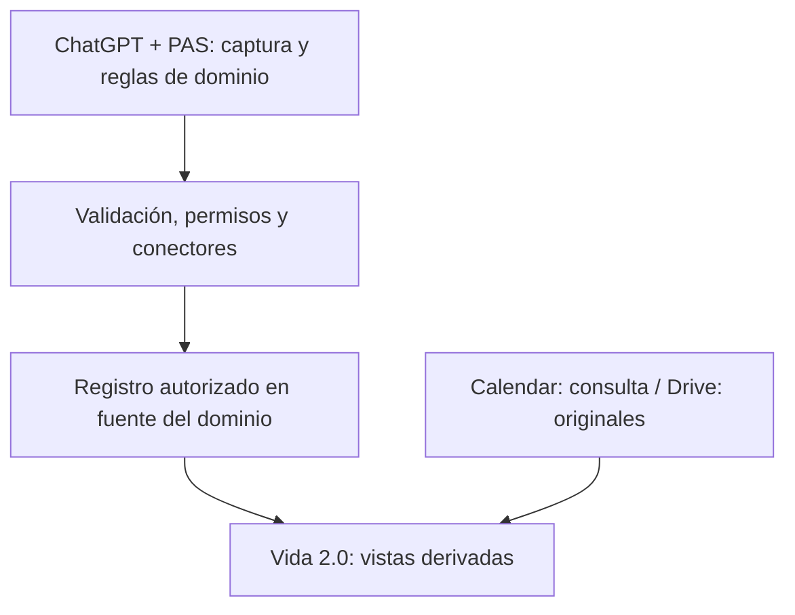

# Vida 2.0 — Caso de estudio

**Diseño y desarrollo:** [Francisco Vitar](https://github.com/franciscovitar) · **Tipo:** proyecto personal, producto web e integraciones.

**[Explorar la demo pública](https://vida-2-0-demo-genova.vercel.app/)** · [Caso de estudio en el portfolio](https://franvitar.genovasite.com/work/vida-2?lang=es) · [Ver el código del sistema original](https://github.com/franciscovitar/vida-2.0)

## El problema

La información cotidiana suele quedar distribuida entre aplicaciones y fuentes diferentes: tareas, proyectos, agenda, entrenamiento, alimentación, salud y finanzas. Registrar algo puede ser sencillo, pero interpretar cómo se relaciona con el resto requiere volver a buscar y reconstruir contexto.

## La propuesta

Vida 2.0 conecta esas áreas sin duplicar las fuentes de verdad. La arquitectura de captura documentada contempla que el usuario registre información en una conversación, el Personal AI System la interprete según el dominio y que un conector autorizado escriba **cuando esa operación esté permitida**. La aplicación web lee los datos y presenta métricas, evolución, comparaciones y próximos pasos. El recorrido documentado no equivale a afirmar que todas las rutas estén activas en producción.

El código del sistema original está separado de esta demostración. No se exponen datos personales, credenciales ni integración con el dispositivo de salud.

## Qué muestra la demo

Una persona y un escenario completamente ficticios con **15 vistas en cuatro áreas**:

- **Organizar:** tareas, hábitos, proyectos, agenda, objetivos y revisión semanal.
- **Cuidarme:** registro de series y cardio, progreso de fuerza, nutrición, cobertura de nutrientes y salud explicable.
- **Aprender:** siete mazos de ejemplo con 44 tarjetas, repaso y práctica de inglés.
- **Vivir:** presupuesto y capacidad, conciliación de un extracto sintético, lista de compras y reposición, películas y series.

El visitante puede crear, editar, revisar y deshacer cambios. Los módulos recalculan información a partir del estado en memoria y vuelven al escenario inicial al recargar. La captura conversacional de la demo es **un intérprete local por reglas, no una IA**.

### Recorrido de 90 segundos

1. Desde «Hoy», elegí **Recorrido guiado · 90 s**.
2. Abrí «Registrar», seleccioná el gasto de supermercado y confirmá la vista previa.
3. Observá el cambio en Finanzas, el disponible y los movimientos.
4. Terminá en «Cómo funciona», comparando la demo con la arquitectura del sistema original.

## Decisiones de ingeniería

| Decisión | Motivo |
| --- | --- |
| Fuentes canónicas por dominio en el original | Evitar una base paralela y reducir inconsistencias. |
| Políticas de escritura, propuestas e idempotencia | Proteger operaciones sensibles y prevenir duplicados; algunas rutas permanecen detrás de flags. |
| Demo estática con JavaScript modular | Compartir el producto sin cuentas ni configuración, con cero dependencias instalables y comportamiento reproducible. |
| Estado en memoria y deshacer | Permitir interacción segura sobre datos ficticios sin retener datos del visitante. |
| Cálculos puros probados | Hacer auditables e1RM, MET-min, presupuesto, conciliación, reposición y cobertura de nutrientes. |
| CSP restrictiva y fuentes locales | Evitar conexiones externas o cargas de scripts no autorizados. |

## Evidencia y límites

- **Pruebas:** suite de Node sobre lógica y plantillas. GitHub Actions ejecuta esas pruebas y un recorrido real con Playwright/Chromium en cada actualización prevista.
- **Responsive:** verificación manual de las 15 vistas en 390, 820 y 1440 px, sin desbordamiento horizontal en la versión revisada.
- **Seguridad de demo:** `connect-src 'none'`, datos sintéticos y ninguna cuenta conectada. Esto no equivale a una auditoría integral de seguridad.
- **Sistema original:** Next.js, React, TypeScript, autenticación, Postgres y fuentes externas. Las capacidades detrás de flags no se presentan como habilitadas en producción.
- **Permisos concretos:** en la interfaz original Notion y Calendar se consultan en modo lectura; las rutas de escritura adicionales dependen de flags y de controles por operación. Ni esta demo ni este documento certifican una escritura real.
- **Alcance:** no hay usuarios reales, métricas comerciales, recomendaciones clínicas, IA en el navegador ni datos sincronizados. No se inventan resultados de adopción.

## Para explorar el código

- [`src/domain/`](../src/domain/) — reglas y cálculos separados del DOM.
- [`src/views/`](../src/views/) — interfaces que devuelven plantillas.
- [`app.js`](../app.js) — eventos, estado y deshacer.
- [`qa/browser_e2e.py`](../qa/browser_e2e.py) — recorrido automatizado para Chromium.
- [Roadmap y pruebas observadas](./SHOWCASE_ROADMAP.md) — decisiones, alcance y registros de QA.

**English summary:** Vida 2.0 is a personal information system integrating planning, health, training, learning, and finances. The public demo uses isolated synthetic data and local interactions to explain the product. The connected Next.js application and its integrations live in a separate repository.
